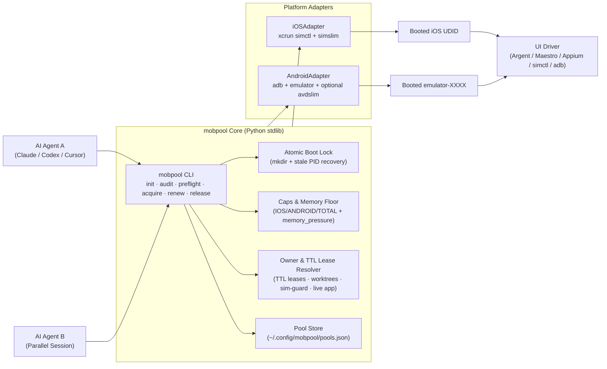
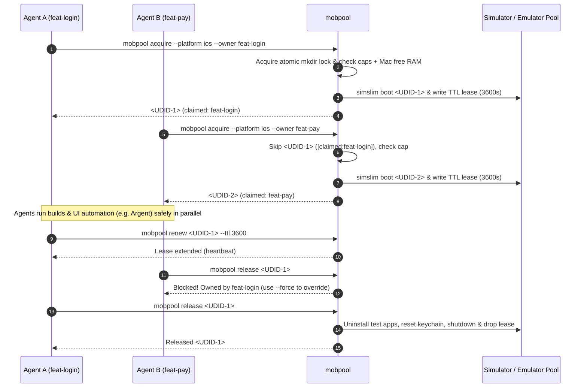

<div align="center">

# mobpool

**Unified iOS Simulator & Android Emulator Pool, TTL Lease, and Slimming Guardrails for AI Coding Agents**

[](https://www.python.org/)
[-2ea44f)](pyproject.toml)
[](#dependencies)
[](#dependencies)
[](skill/SKILL.md)

*Stop parallel AI agents from melting your Mac or killing each other's simulators and emulators.*

</div>

---

## The Problem

When multiple AI coding agents (Claude Code, Codex, Cursor, OpenMyBot, etc.) run mobile builds and UI verifications in parallel on one Mac:

- **Thermal & RAM meltdown**: Agents independently call `xcrun simctl boot` or `emulator -avd`, stacking 4–6 full virtual devices until macOS thrashes swap.
- **Friendly fire**: Agent B shuts down or wipes Agent A's active simulator mid-test because there is no shared ownership model.
- **Broken PID locks**: Traditional PID-based claims vanish immediately when an agent's short-lived shell tool call exits.
- **Fragmented workflows**: iOS (`simctl` / `simslim`) and Android (`adb` / `emulator` / `avdslim`) require completely different commands, IDs, and boot flags.

## Why `mobpool`?

`mobpool` owns **device lifecycle** (pool selection, concurrency caps, host memory floor, atomic boot locks, TTL leases, and slim booting) and hands off **UI interaction** to your driver of choice (such as Argent, Maestro, Appium, `simctl`, or `adb`).

- **One CLI for iOS + Android** — Same `init`, `audit`, `preflight`, `acquire`, `renew`, `release`, `owners`, and `slim` workflow across both platforms.
- **TTL + heartbeat leases** — Leases persist across transient agent subprocesses and auto-expire if a session crashes without cleanup.
- **Atomic boot lock** — `mkdir`-based lock with dead-PID stale-lock recovery prevents concurrent agents from racing past your device caps.
- **Host memory & cap guardrails** — Enforces per-platform caps (`IOS_CAP`, `ANDROID_CAP`), machine-wide `TOTAL_CAP`, and a macOS `memory_pressure` free-memory floor before booting.
- **External owner awareness** — Detects external worktree claims, legacy `sim-guard` / `agent-device` claims, and live app processes (`MOBPOOL_APP_ID`) so agents never touch someone else's device.
- **Slim by default** — Uses `simslim` on iOS and `avdslim` (or lightweight emulator flags when `avdslim` is absent) on Android.
- **Zero Python dependencies** — Pure Python 3.10+ standard library. Ships with an agent-ready [`skill/SKILL.md`](skill/SKILL.md).

---

## Architecture



## Multi-Agent Lease Lifecycle



---

## Dependencies

`mobpool` itself has **zero external Python package dependencies** (standard library only). Platform features rely on the native SDK tools installed on your Mac:

| Layer | Dependency | Required? | Purpose & Install |
|---|---|---|---|
| **Core Runtime** | **Python 3.10+** | Required | Runs `mobpool` using stdlib only (`pyproject.toml`) |
| **Host Guard** | **macOS `memory_pressure`** | Built-in (macOS) | Checks free memory % before booting (gracefully skipped if unavailable) |
| **iOS** | **Xcode Command Line Tools** (`xcrun simctl`, `plutil`) | Required for iOS | Lists, inspects, cleans apps, resets keychain on iOS simulators |
| **iOS** | **[`simslim`](https://github.com/mobai-app/simslim)** | Required for iOS | Boots simulators in slim mode, disables background daemons, reports RAM/CPU (`brew install mobai-app/tap/simslim`) |
| **Android** | **Android SDK `platform-tools`** (`adb`) | Required for Android | Maps AVDs to `emulator-XXXX` serials, waits for boot, cleans apps, shuts down |
| **Android** | **Android SDK `emulator`** + ≥1 AVD | Required for Android | Lists AVDs and boots emulators (`$ANDROID_HOME/emulator/emulator`) |
| **Android** | **`avdslim`** | Optional | Applies AVD slim profile; if absent, `mobpool` falls back to lightweight boot flags (`-no-audio -no-boot-anim -gpu host -no-snapshot-save`) |
| **UI Automation** | **Argent / Maestro / Appium** | Optional | Drives UI taps, typing, and screenshots against the booted `UDID` or `emulator-XXXX` |

---

## Installation

### Option 1: Symlink to `PATH` (Recommended, zero build step)

```bash
git clone https://github.com/zereight/mobpool.git ~/Documents/mobpool
mkdir -p ~/.local/bin
ln -sf ~/Documents/mobpool/bin/mobpool ~/.local/bin/mobpool

# Verify
mobpool audit
```

### Option 2: Editable `pip` install

```bash
git clone https://github.com/zereight/mobpool.git
cd mobpool
pip install -e .
```

### Option 3: Register as an AI Agent Skill

Link [`skill/`](skill/SKILL.md) into your agent's global skill directory so agents automatically run `mobpool` before booting or shutting down any virtual device:

```bash
# Shared agent skills SSOT (Codex, Cursor, Pi, etc.)
ln -sfn ~/Documents/mobpool/skill ~/.agents/skills/mobpool

# Claude Code / OpenMyBot
ln -sfn ~/.agents/skills/mobpool ~/.claude/skills/mobpool
```

---

## Quick Start

```bash
# 1. Select and prepare slim pool devices (skips devices owned by other sessions)
mobpool init --platform all

# 2. Inspect running devices, RAM/CPU, slim status, leases, and Mac free memory
mobpool audit

# 3. Acquire a slim iOS simulator or Android emulator (1h TTL by default)
mobpool acquire --platform ios --owner feat-login
mobpool acquire --platform android --owner feat-login --ttl 1800

# 4. Extend an active lease during long test runs
mobpool renew <udid-or-avd-or-serial> --ttl 3600

# 5. Clean installed apps, shut down cleanly, and drop the lease
mobpool release <udid-or-avd-or-serial>
```

### Example `mobpool audit` Output

```text
Booted devices: 1/2 (iOS 1/2, Android 0/1), total RAM 2.84 GB
  [ios] 7E5F796B-FB31-4E7E-9F41-2197B7FDC00E  iPhone 17 (iOS 27.2)  2.84 GB RAM  18.2% CPU  slim (163/173)  [claimed:feat-login]
Mac memory free: 64% (floor 25%)
```

Use `--json` for machine-readable output in scripts and agent pipelines:

```bash
mobpool audit --json
```

---

## CLI Reference

| Command | Flags | Description |
|---|---|---|
| `mobpool init` | `--platform ios\|android\|all`, `--count N` | Picks unowned devices (preferring plain `iOS-X-Y` runtimes), applies slimming, and saves pool to `~/.config/mobpool/pools.json` |
| `mobpool audit` | `--platform ios\|android\|all`, `--json` | Lists booted devices, RAM/CPU usage, slim status, active owners, and Mac free memory % |
| `mobpool preflight` | `--platform ios\|android` | Runs audit and exits non-zero if platform cap, total cap, or Mac memory floor would be exceeded |
| `mobpool acquire` | `--platform ios\|android`, `--ttl SEC`, `--owner LABEL` | Atomically acquires lock, checks caps/memory, boots a free slim pool device, and writes a TTL lease |
| `mobpool renew <id>` | `--ttl SEC` | Extends an active TTL lease (heartbeat) by UDID, AVD name, or `emulator-XXXX` serial |
| `mobpool release <id>` | `--keep-apps`, `--force` | Refuses to kill non-self owned devices unless `--force`; cleans user apps, shuts down, and removes lease |
| `mobpool owners` | `--platform ios\|android\|all` | Lists all currently claimed devices and their resolved owner source |
| `mobpool slim <id>` | `--platform ios\|android` | Applies the slimming profile (`simslim on` / `avdslim on`) to a specific device |

---

## Configuration

`mobpool` resolves settings in the following precedence order:

1. **Environment variables** (highest priority)
2. **Local config file**: `~/.config/mobpool/config.json` (override path via `MOBPOOL_CONFIG_FILE`)
3. **Built-in defaults**

### Example `~/.config/mobpool/config.json`

```json
{
  "ios_cap": 2,
  "android_cap": 1,
  "total_cap": 2,
  "min_free_pct": 25,
  "default_ttl_sec": 3600,
  "simslim_except": "store,web",
  "app_id": "com.example.app.dev",
  "worktree_claims_dir": "~/.cache/worktree-claims"
}
```

### All Settings

| Env Variable | `config.json` Key | Default | Purpose |
|---|---|---|---|
| `MOBPOOL_CONFIG_DIR` | — | `~/.config/mobpool` | Base directory for config, pools, claims, and locks |
| `MOBPOOL_CONFIG_FILE` | — | `<config_dir>/config.json` | Path to local JSON config file |
| `MOBPOOL_IOS_CAP` | `ios_cap` | `2` | Max concurrently booted iOS simulators |
| `MOBPOOL_ANDROID_CAP` | `android_cap` | `1` | Max concurrently booted Android emulators |
| `MOBPOOL_TOTAL_CAP` | `total_cap` | `2` | Max concurrently booted virtual devices machine-wide |
| `MOBPOOL_MIN_FREE_PCT` | `min_free_pct` | `25` | Minimum macOS free memory % required before booting |
| `MOBPOOL_CLAIM_TTL` | `default_ttl_sec` | `3600` | Default lease duration in seconds |
| `MOBPOOL_OWNER` | `owner_label` | workspace basename | Default owner label written into new leases |
| `MOBPOOL_ANDROID_FLAGS` | `android_flags` | `-no-audio -no-boot-anim -gpu host -no-snapshot-save` | Lightweight Android emulator boot flags |
| `SIMSLIM_EXCEPT` | `simslim_except` | `store,web` | `simslim` daemon categories kept enabled on iOS |
| `MOBPOOL_APP_ID` | `app_id` | unset | Bundle/package ID treated as an active owner while running |
| `MOBPOOL_WORKTREE_CLAIMS_DIR` | `worktree_claims_dir` | unset | Directory of `<device_id>/owner` external worktree claim files (also checks `RB_CLAIMS`) |
| `MOBPOOL_FORCE_RELEASE` | — | `0` | Set `1` to bypass non-self owner protection on `release` |

---

## Ownership & Safety Model

Before booting, selecting pool devices, or shutting anything down, `mobpool` resolves device ownership across four layers:

1. **`mobpool` TTL leases** (`~/.config/mobpool/claims/`) — Active leases with expiration timestamps and heartbeat renewal.
2. **External worktree claims** (`MOBPOOL_WORKTREE_CLAIMS_DIR` / `RB_CLAIMS`) — Respects devices claimed by build scripts or git worktrees.
3. **Legacy `sim-guard` / `agent-device` claims** — Seamlessly coexists with existing simulator guard setups.
4. **Running target app detection** (`MOBPOOL_APP_ID`) — Marks a booted device as owned if your dev app process is actively running on it.

Any device owned by another session is marked `[claimed:...]` in `audit`, skipped by `init` and `acquire`, and protected from `release` unless explicitly overridden with `--force` or `MOBPOOL_FORCE_RELEASE=1`.

---

## Project Structure

```text
mobpool/
├── bin/mobpool                  # Executable CLI entrypoint
├── pyproject.toml               # Python 3.10+ packaging (zero dependencies)
├── skill/SKILL.md               # Drop-in AI agent skill instructions
├── src/mobpool/
│   ├── cli.py                   # Unified CLI subcommands
│   ├── config.py                # Env + local config.json loader
│   ├── claims.py                # TTL leases & external owner resolution
│   ├── lock.py                  # Atomic mkdir boot lock + stale recovery
│   ├── memory.py                # macOS memory_pressure check
│   ├── pool_store.py            # Pool persistence (~/.config/mobpool/pools.json)
│   └── platforms/
│       ├── base.py              # PlatformAdapter interface
│       ├── ios.py               # xcrun simctl + simslim adapter
│       └── android.py           # adb + emulator + optional avdslim adapter
└── tests/                       # Unit & CLI integration tests
```

## Development & Tests

```bash
PYTHONPATH=src python3 -m unittest discover -s tests -v
```
